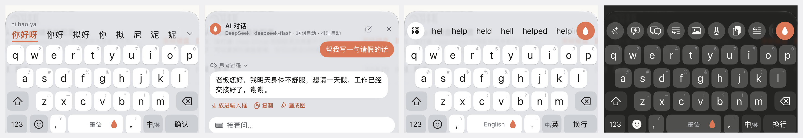

<div align="center">


# Moyu (墨语)

**An open-source Chinese AI keyboard for iOS: chat with an AI agent right inside the keyboard, without leaving the conversation you're in. The Pinyin engine is written from scratch too.**

No backend. Your API keys stay in the iPhone Keychain, and requests go straight to the provider you choose.

[中文](README.md) · [Install](#install) · [How it's built without a Mac](#5-built-without-a-mac) · [Handoff notes (Chinese)](docs/16-交接文档.md)


</div>



<sub>These screenshots were captured by CI after it opened the Moyu keyboard in the iOS 27 simulator. Left to right: typing Chinese (nihaoya), AI chat inside the keyboard, English completion (hel), dark mode. The chat text is demo content filled in by the test script.</sub>

---

## Why

Most Chinese keyboards either can't use your own AI, or send what you type to their servers. Moyu aims for:

- Pinyin typing that is good on its own, not a demo with AI bolted on;
- Chatting with AI, and having it polish, translate, reply or draw, right from any app's text field, without switching apps;
- Your own API key, so you decide what you pay for and where your text goes.

## Highlights

### 1. Chat with an AI agent right inside the keyboard

This is what sets Moyu apart from mainstream keyboards. Normally, asking an AI something while chatting means copying text, switching to an AI app, asking, copying the answer, and switching back. In Moyu **the whole conversation happens inside the keyboard**, and one tap puts the answer into the text field.


- **Never leave the app you're in**: open the keyboard in any text field and chat. Tap "insert" to put the answer in the field, copy it, or turn it into an image.
- **Knows what you're writing**: the text before the cursor in the current field is passed to the model, so "help me reply to him" or "make this more polite" works without pasting the original again.
- **Uses tools on its own**:
  - for news, weather, prices or dates it searches Bing first and answers from the results, with the cited pages shown above the answer (web search can be off / auto / always);
  - start a message with 画一张 / 帮我画 ("draw a...") or switch on "draw next reply", and it calls the image model directly, without switching pages.
- **Adjustable**: reasoning level (auto / fast / deep), answer length, persona (concise assistant, writing helper, translator, or your own), and how many turns of context to keep. These toggles sit where the candidate bar normally is, one tap to switch.
- **Transparent**: streamed output; a reasoning model's thinking can be expanded.
- **History stays on the device**, and you can browse and clear it in the host app.
- **Bring your own model**: DeepSeek, Qwen, Kimi, Zhipu, Doubao, OpenAI, Claude, Gemini, or any OpenAI-compatible endpoint.

### 2. A Pinyin engine written from scratch

The engine doesn't depend on Rime or the system IME. It lives in [`ios/Shared/IMECore`](ios/Shared/IMECore) and serves both the QWERTY and 9-key (T9) layouts.

- **Sentence conversion**: dynamic programming over the Pinyin string picks the best segmentation. You can pick word by word, and the rest keeps converting.
- **Abbreviated sentences**: `wbzd` → 我不知道 ("I don't know"). Choices you make are learned, so after one pick `wcgl` → 我吃过了.
- **Sentence-level typo correction**: a two-layer DP allows one mistyped letter anywhere in the sentence (adjacent key, swapped letters, extra or missing letter). `jintianhebmang` → 今天很忙, `nihap` → 你好.
- **Personal dictionary**: words you typed rank higher next time, and the app lets you view, search and delete them.
- **New words every day**: a new-word list lives in the repo ([`tools/dict/hot_words.tsv`](tools/dict/hot_words.tsv)) and the keyboard fetches it daily, so new slang works without reinstalling.
- **Next-word prediction** learned from real Chinese sentences (Tatoeba); after a full sentence it offers fitting punctuation first.
- **English completion**: type `hel` in English mode and get hello, help; one tap completes the word.
- **ü and polyphones**: `lve` and `lue` both give 略. Each reading of a polyphonic character is ranked by its real frequency, so rare classical readings don't take over sentences.
- **Lexicon**: 274k entries in a memory-mapped binary file. Keyboard extensions get very little memory, so the dictionary can't be loaded whole. It's built from jieba, rime-essay, OpenCC and rime-ice by the scripts in [`tools/dict`](tools/dict).

Measured numbers, without cherry-picking:

| Metric | Result |
|---|---|
| Converting a long sentence (CI Mac) | ~1.4 ms; ~9 ms with typo correction |
| Fully correct sentences, held-out sets of 45 / 50 | 41 / 43 |
| One random typo per sentence (182 sentences) | 100 fixed and ranked first, 15 more ranked second |
| Correctly typed input wrongly "corrected" to first place | 0 of 225 |

Most remaining errors are homophones that need context (菜/才, 哪里/那里). A bigram language model is next.

### 3. More AI features

- **Polish, translate, reply, expand**: the result replaces the original text in the field, with a choice of tone.
- **Image generation**: Seedream (Volcengine) and Wanx (Alibaba), with aspect ratio and style options. Images can be saved to Photos.
- **AI next-sentence suggestions** in the candidate bar after you commit text.
- **11 provider presets**: DeepSeek, Qwen, Kimi, Zhipu GLM, Doubao, OpenRouter, SiliconFlow, OpenAI, Anthropic Claude, Seedream, Wanx. Pick one and paste a key. Any OpenAI-compatible endpoint and Gemini also work.
- **Robust against provider churn**: when a model is retired, Moyu looks up an available one and switches. It also tolerates gateways that break the SSE format (full-width colons, missing blank lines between events).

### 4. Working around iOS keyboard-extension limits

Keyboard extensions are among the most restricted places in iOS:

| Limit | What Moyu does |
|---|---|
| Keyboard extensions can't use the microphone | The host app runs a background voice session. The keyboard signals start/stop with Darwin notifications, and the transcript comes back through notification state values |
| Free signing has no App Group, so the app and keyboard are separate sandboxes | Tries App Group, then a Keychain access group, then a marked pasteboard handoff, and shows in the UI which path works |
| Setting the keyboard height directly is ignored | Content-driven sizing; the keyboard can be dragged taller or shorter in place (verified in the simulator) |
| Tight memory | Memory-mapped lexicon |

### 5. Built without a Mac

The author only has a Windows PC. The whole project was built without a Mac:

- **Build and package**: [GitHub Actions](.github/workflows/build.yml) compiles an unsigned IPA on macOS runners.
- **Simulator test run**: [a second workflow](.github/workflows/sim-check.yml) opens the Moyu keyboard in the iOS simulator, walks through pages and heights from a script, and uploads a screenshot of each step. The image above came from it.
- **Tests run before compiling**; the build stops if they fail:
  - [`tools/imecheck`](tools/imecheck/main.swift) runs the Pinyin engine against the real lexicon (54 checks).
  - [`tools/apicheck`](tools/apicheck/main.swift) tests the AI request logic against a fake server: model fallback, error messages, web-search parsing and more (35 checks).
- **Generated project file**: `ios/AIKeyboard.xcodeproj` is generated from the source tree by [`scripts/gen_xcodeproj.py`](scripts/gen_xcodeproj.py), so it can be maintained from Windows.

### 6. Privacy

- No server of our own, and no analytics, tracking or crash reporting.
- API keys are stored in the system Keychain.
- Typing works without Full Access; only the AI features need network access.
- Text is sent only when you use an AI feature, and only to the provider you configured.

## Where it's going: an extensible keyboard

Today every feature in Moyu is hard-coded. The plan is to split it into modules and open an API, so users can add their own things to the keyboard without changing code or rebuilding:

- **Your own tools**: describe a tool in a config file: name, icon, prompt, which model to use or your own HTTP endpoint to call, and whether the result replaces the text, gets inserted, or is shown in a panel. It then appears in the keyboard toolbar. Examples: "turn this into a weekly report", "track this parcel number", "ask my own knowledge base".
- **Let the agent use them too**: the in-keyboard agent already searches the web and draws; user-added tools would become tools it can decide to call during a conversation.
- **Skins**: colors, key shapes and corner radius, fonts and the space-bar mascot packaged as a skin that can be imported and shared.
- **Dictionaries**: import domain dictionaries (medicine, law, programming...), dialect dictionaries, or dictionaries in formats other keyboards use, all taking part in sentence conversion alongside the built-in lexicon.

One constraint up front: iOS doesn't allow keyboard extensions to download and run new code, so extensions will be declarative (config + HTTP endpoints), not plug-in programs. That's also safer: what an extension can do and where it sends your text is written in its config, in plain sight.

Details (Chinese): [docs/17-模块化与开放接口设想.md](docs/17-模块化与开放接口设想.md).

## Install

> **Why isn't it on the App Store?** Moyu is a one-person side project. Publishing on the App Store requires the Apple Developer Program at $99 per year, which I currently can't afford. So Moyu is distributed as open source and sideloaded.

How to install today (free, but it has to be re-signed every 7 days):

1. Download a package from [Releases](https://github.com/904177233/ximake-keyboard/releases/latest). Each version has two:
   - `…-appgroup-unsigned.ipa` declares an App Group so the app and keyboard can share settings. Try this one first.
   - `…-unsigned.ipa` is for signing tools that don't support App Groups.

   For the latest development build, download the most recent run from [Actions](https://github.com/904177233/ximake-keyboard/actions/workflows/build.yml) (requires a GitHub login; files are kept for 7 days).
2. Sign and install it with your free Apple ID using SideStore, AltStore, iloader or similar.
3. Settings › General › Keyboard › Keyboards › Add New Keyboard › 墨语, then turn on Allow Full Access.
4. Open the Moyu app, go to the AI tab, pick a provider and paste your key.

## Build it yourself

```bash
python scripts/gen_xcodeproj.py          # regenerate the Xcode project after adding/removing Swift files
python scripts/qa/final_acceptance.py    # static checks, no Mac needed
python tools/dict/build_binary.py --eval # rebuild the lexicon and run the sentence benchmark
python tools/dict/typo_eval.py           # tune typo correction
```

With a Mac, open `ios/AIKeyboard.xcodeproj` in Xcode. Without one, fork the repo, push, and download the IPA from Actions.

## Roadmap

- [ ] Open API for tools, skins and dictionaries (see above)
- [ ] Bigram language model for context-dependent homophones
- [ ] Testing on more devices (mainly iPhone 14 Pro / iOS 27 so far)
- [ ] Typo correction for the 9-key layout
- [ ] English UI
- [ ] TestFlight / App Store, if a developer account ever becomes affordable

## Contributing

Issues and PRs are welcome, especially: sentences that convert wrong (please include what you typed and the candidates you saw), device-specific problems, and better frequency data. See [CONTRIBUTING.md](CONTRIBUTING.md).

## License

The code is released under [GPL-3.0](LICENSE). Data sources and their licenses are listed in [THIRD_PARTY_NOTICES.md](THIRD_PARTY_NOTICES.md). The rime-ice data is GPL-3.0, so builds that include the lexicon are distributed under GPL-3.0 as a whole.
