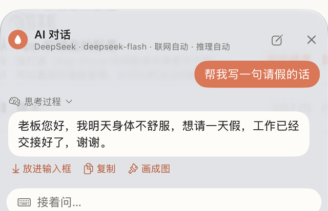

<div align="center">


# 墨语 Moyu

**一个开源的 iOS 中文 AI 输入法：不用离开聊天框，直接在键盘里和 AI Agent 对话；拼音引擎也是自己写的。**

没有后端，API Key 只存在你手机的钥匙串里，请求直连你自己选的服务商。

[English](README.en.md) · [下载](https://github.com/904177233/ximake-keyboard/releases/latest) · [安装](#安装) · [构建](#5-没有-mac-怎么开发) · [交接文档](docs/16-交接文档.md)


</div>


<sub>上图是 CI 在 iOS 27 模拟器里真的弹出墨语键盘后自动截的图，从左到右：打中文（nihaoya）、英文补全（hel）、键盘里的 AI 对话、长按空格说话。对话和语音里的文字是测试脚本填的演示内容。</sub>

---

## 为什么做这个

市面上的中文输入法要么不能接自己的 AI，要么要把你打的字传到它们的服务器。墨语想做的是：

- 拼音打字本身要好用，不能因为加了 AI 就变成半成品；
- 在任何 App 的聊天框里都能直接和 AI 对话、让它润色、翻译、回复、画图，不用来回切 App；
- 用你自己的 Key，钱花在哪、字发给谁，你自己说了算。

## 亮点

### 1. 在键盘里直接和 AI Agent 对话

这是墨语和主流输入法最不一样的地方。平时在微信里想问 AI，要复制、切到 AI App、提问、再复制回来、切回微信。在墨语里，**整个对话都在键盘里完成**，问完一键把回答放进聊天框。



- **不离开当前 App**：在任何输入框里打开键盘就能聊，回答点「放进输入框」就上屏，或者复制、直接「画成图」。
- **知道你在写什么**：会把当前输入框里光标前面的文字一起交给模型，「帮我回他」「把这段改得客气点」这种话不用再贴一遍原文。
- **会自己用工具**：
  - 问到新闻、天气、价格、日期这类问题时自动先用必应搜索，再根据搜到的网页回答，回答上方能展开看引用了哪些网页（联网可以设成关 / 自动 / 总是）；
  - 说「画一张……」「帮我画……」，或者打开「下一句画图」，就直接调画图模型出图，不用换页面。
- **能调**：推理档位（自动 / 快速 / 深度思考）、回答长短、人设（简洁助手、写作帮手、翻译官……也能自己写）、带几轮上下文。这些开关就放在候选栏的位置，点一下就切换。
- **看得见过程**：流式输出；推理模型的思考过程可以展开看。
- **记录在 App 里**：对话记录存在本机，宿主 App 里能翻看和清空。
- **用你自己的模型**：DeepSeek、通义千问、Kimi、智谱、豆包、OpenAI、Claude、Gemini 或任何 OpenAI 兼容接口都行。

### 2. 自己写的拼音引擎

不依赖 Rime 或系统输入法，内核在 [`ios/Shared/IMECore`](ios/Shared/IMECore)，26 键和九宫格共用一套。

- **整句转换**：在拼音串上做动态规划，找分数最高的切法；可以逐词选，选一个词，剩下的拼音接着转换。
- **简拼整句**：`wbzd` → 我不知道，`wcgl` 选过一次「我吃过了」以后就排第一。
- **整句纠错**：整句 DP 分两层，允许句子里有一个字母打错（按到相邻键、两个字母打反、多打、少打）。`jintianhebmang` → 今天很忙，`nihap` → 你好。
- **个人词库**：打过的词下次排在前面，App 里可以查看、搜索、删除。
- **新词每天更新**：新词表放在仓库里（[`tools/dict/hot_words.tsv`](tools/dict/hot_words.tsv)），键盘每天拉一次，不用重装就能打出新流行的词。
- **联想**：上屏后按真实中文句子里的搭配猜下一个词（Tatoeba 例句统计），一句话打完先给合适的标点。
- **英文补全**：英文模式下打 `hel` 就给 hello、help，点一下换成整个词。
- **ü 和多音字**：`lve` / `lue` 都能打出「略」；多音字的每个读音按真实字频排序，不会让古音冒出来抢位置。
- **词库**：27.4 万词条，做成内存映射的二进制文件（键盘扩展能用的内存很少，不能整个读进来）。数据来自 jieba、rime-essay、OpenCC、rime-ice，构建脚本在 [`tools/dict`](tools/dict)。

数字都是实测的，不挑好看的说：

| 项目 | 结果 |
|---|---|
| 长句一次转换（CI 的 Mac 上） | 约 1.4 毫秒；带纠错约 9 毫秒 |
| 没参与调参的 45 句 / 50 句整句全对 | 41 / 43 句 |
| 每句随机打错一个字母（182 句） | 100 句纠对并排第一，另有 15 句排第二 |
| 打对的句子被误纠成首选 | 225 条里 0 条 |

剩下的错误大多是同音字要看上下文（菜 / 才、哪里 / 那里），下一步要做二元语言模型。

### 3. 其它 AI 功能

- **润色、翻译、回复、扩写**：结果直接替换输入框里的原文；可以选语气。
- **画图**：即梦（Seedream）、通义万相，可以选画幅和风格，画过的图能存进相册。
- **AI 猜下一句**：上屏后在候选栏给出可能的下一句。
- **11 家服务商预设**：DeepSeek、通义千问、Kimi、智谱、豆包、OpenRouter、硅基流动、OpenAI、Anthropic Claude、即梦、通义万相。选一家、粘贴 Key 就能用，也支持任何 OpenAI 兼容接口和 Gemini。
- **抗折腾**：模型名下线了会自动查可用模型换上；兼容不守 SSE 规范的网关（全角冒号、分片之间没空行这种）。

### 4. 绕开 iOS 键盘扩展的限制

键盘扩展是 iOS 里限制最多的地方，很多「理所当然」的功能都得绕路：

| 限制 | 墨语的做法 |
|---|---|
| 键盘扩展不能用麦克风 | 宿主 App 开一个后台语音会话，键盘用 Darwin 通知喊开始/结束，识别结果经系统通知的状态值传回键盘 |
| 免费签名没有 App Group，App 和键盘是两个隔离的沙盒 | 依次尝试 App Group、钥匙串访问组、剪贴板标记，并在界面上如实显示是否打通 |
| 直接给键盘设高度会被系统忽略 | 用内容把高度撑起来，键盘可以在键盘上直接拖高拖低（模拟器实测） |
| 内存很紧 | 词库用内存映射，不整块读入 |

细节见 [docs/09-iOS键盘扩展能力边界技术约束清单.md](docs/09-iOS键盘扩展能力边界技术约束清单.md)。

### 5. 没有 Mac 怎么开发

作者只有一台 Windows 电脑，整个项目是在没有 Mac 的情况下做出来的：

- **编译和打包**：推到 GitHub，[Actions](.github/workflows/build.yml) 用 macOS 机器编译出未签名的 IPA。
- **模拟器实测**：[另一个工作流](.github/workflows/sim-check.yml)在 iOS 模拟器里真的弹出墨语键盘，按脚本走一遍各个页面和高度，每一步截图上传。上面那张图就是这么来的。
- **测试先跑**：编译之前先跑两套测试，失败就不往下编。
  - [`tools/imecheck`](tools/imecheck/main.swift)：用真词库跑拼音内核，54 项检查。
  - [`tools/apicheck`](tools/apicheck/main.swift)：用假服务器测 AI 请求逻辑（换模型、报错、联网搜索解析等），35 项检查。
- **工程文件是生成的**：`ios/AIKeyboard.xcodeproj` 由 [`scripts/gen_xcodeproj.py`](scripts/gen_xcodeproj.py) 从源码树生成，Windows 上也能改。

### 6. 隐私

- 没有自己的服务器，没有统计、埋点或崩溃上报。
- API Key 存在系统钥匙串里。
- 不开「完全访问」也能正常打字，只是 AI 连不上网。
- 只有你点了 AI 功能时，相关文字才会发给你自己配置的服务商。

## 以后想做成什么样：可以扩展的输入法

现在墨语的功能都是写死在代码里的。接下来想把它拆成模块，再开放一套接口，让用户不用改代码、不用重新编译，就能往输入法里加自己的东西：

- **自己的工具**：用一份配置描述一个工具（名字、图标、提示词、用哪个模型，或者调用你自己的 HTTP 接口，结果是替换原文、插入还是弹出来看），它就出现在键盘的工具栏里。比如「把这段改成周报格式」「查一下这个快递单号」「调用我自己的知识库」。
- **让 Agent 也能用这些工具**：键盘里的对话现在会联网搜索和画图，以后用户加的工具也能让 Agent 在对话里自己决定什么时候调用。
- **皮肤**：颜色、键的形状和圆角、字体、空格上的小形象都放进皮肤包，可以导入、分享别人做的皮肤。
- **词库**：导入专业词库（医学、法律、编程……）、方言词库，或者别的输入法常用格式的词库，和内置词库一起参与整句转换。

有个限制要说在前面：iOS 不允许键盘扩展下载并运行新的代码，所以扩展都会是「配置 + 接口」的形式，不是装插件程序。这样也更安全：扩展能做什么、会把文字发到哪里，都写在配置里，看得见。

详细设想见 [docs/17-模块化与开放接口设想.md](docs/17-模块化与开放接口设想.md)。

## 安装

> **为什么不在 App Store？** 墨语是我一个人业余做的。上架 App Store 需要加入 Apple Developer Program，每年 99 美元，这笔钱我目前负担不起，所以墨语只能以开源加侧载的方式发布。

现在的安装方式（免费，但每 7 天要重签一次）：

1. 到 [Releases](https://github.com/904177233/ximake-keyboard/releases/latest) 下载安装包。每个版本有两个：
   - `…-appgroup-unsigned.ipa`：带 App Group 声明，App 和键盘能共享设置，优先用这个；
   - `…-unsigned.ipa`：签名工具不支持 App Group 时用这个。

   想要最新的开发版，可以在 [Actions](https://github.com/904177233/ximake-keyboard/actions/workflows/build.yml) 里下载最近一次构建（要登录 GitHub，文件保留 7 天）。
2. 用 SideStore、AltStore、iloader 等工具，以自己的免费 Apple ID 签名装到 iPhone。
3. 设置 › 通用 › 键盘 › 键盘 › 添加新键盘 › 墨语，打开「允许完全访问」。
4. 打开墨语 App，在「AI」页选一家服务商、粘贴 Key。

详细步骤和常见问题：[安装与续签指南](docs/04-安装与续签指南.md) · [常见问题](docs/05-常见问题.md)。

## 自己构建

```bash
# 新增或删除 Swift 文件后，重新生成 Xcode 工程
python scripts/gen_xcodeproj.py

# 本地静态检查（不需要 Mac）
python scripts/qa/final_acceptance.py

# 重新生成词库并跑整句评测（需要先下载数据，见 docs/16-交接文档.md）
python tools/dict/build_binary.py --eval

# 纠错调参
python tools/dict/typo_eval.py
```

有 Mac 的话直接用 Xcode 打开 `ios/AIKeyboard.xcodeproj`。没有 Mac 就 fork 本仓库，推送后在 Actions 里拿安装包。

## 目录

```
ios/
├── Shared/                 App 和键盘都编译
│   ├── IMECore/            拼音引擎
│   ├── Networking/         AI 请求：OpenAI 兼容 / Anthropic / Gemini，即梦 / 万相，联网搜索
│   ├── Voice/              App 和键盘之间的语音通道
│   ├── Storage/            配置、钥匙串、App 和键盘共享
│   └── dict/               词库（生成的二进制文件）
├── AIKeyboard/             宿主 App
└── AIKeyboardExtension/    键盘扩展
tools/dict/                 词库构建、整句评测、纠错调参
tools/imecheck/             拼音内核回归测试
tools/apicheck/             AI 请求逻辑测试（假服务器）
scripts/                    工程生成、静态检查、CI 辅助
docs/                       设计文档、限制清单、交接文档
```

## 接下来想做的

- [ ] 工具、皮肤、词库的开放接口（见上一节）
- [ ] 二元语言模型，解决同音字要看上下文的问题
- [ ] 更多真机型号上的测试（目前主要在 iPhone 14 Pro / iOS 27 上用）
- [ ] 九宫格的纠错
- [ ] 英文界面
- [ ] 如果有一天能负担开发者账号，上架 TestFlight / App Store

## 参与

欢迎提 Issue 和 PR，尤其是：打错的整句（请附上你打的拼音和看到的候选）、不同机型上的问题、更好的词频数据。参与方式见 [CONTRIBUTING.md](CONTRIBUTING.md)。

## 许可证

代码以 [GPL-3.0](LICENSE) 发布。词库数据的来源和各自的许可证见 [THIRD_PARTY_NOTICES.md](THIRD_PARTY_NOTICES.md)。其中 rime-ice 的数据是 GPL-3.0，所以带词库的安装包整体也按 GPL-3.0 分发。
